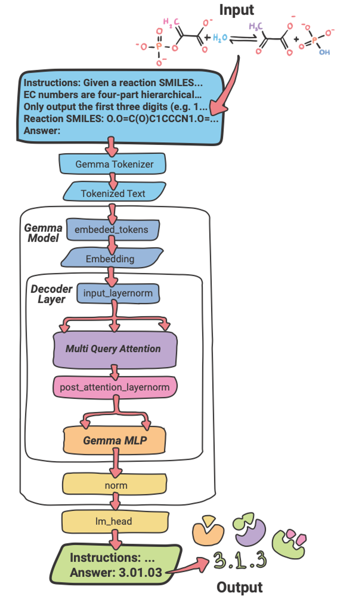
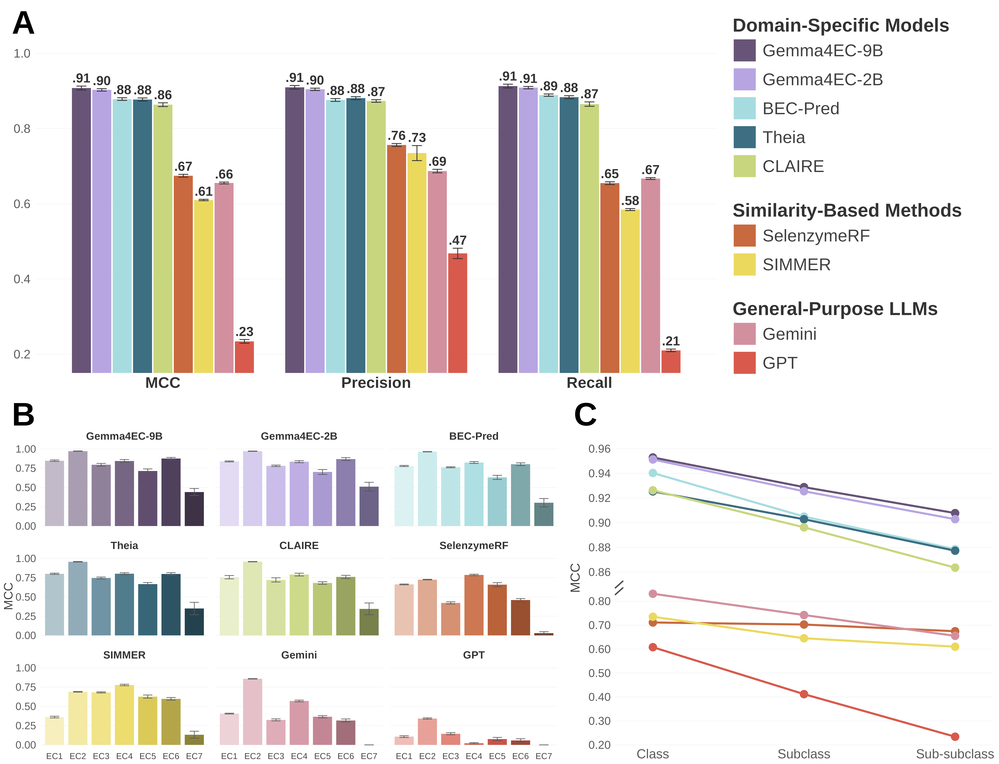
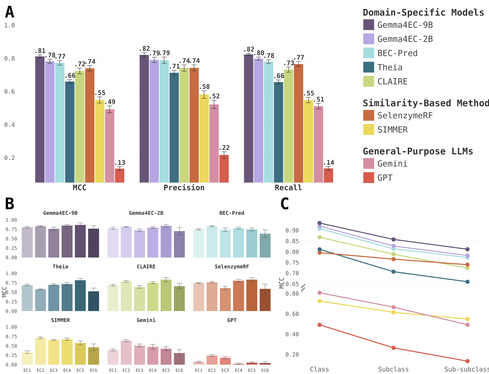

# Gemma4EC

[](LICENSE)
[](https://huggingface.co/PlanesLab/Gemma4EC-9B-Predict)
[](https://huggingface.co/PlanesLab/Gemma4EC-2B-Predict)
[](envs/gemma4ec_env.yaml)

**Gemma4EC predicts the Enzyme Commission (EC) number of a biochemical reaction from its SMILES, and explains the prediction in plain language.**

<table>
<tr>
<td width="55%" valign="top">

Gemma4EC is based on [TxGemma](https://huggingface.co/google/txgemma-9b-predict) (Google), fine-tuned with a small LoRA adapter. It uses reaction SMILES as input, such as `CCO.O=O>>CC=O.OO` and returns the EC class, subclass and sub-subclass (e.g. `1.1.3`). A companion chat then names the likely enzyme and explains its catalytic mechanism.

</td>
<td width="45%" valign="middle" align="center">



</td>
</tr>
</table>

---

## 1. Install

Linux, Python 3.11, conda. A GPU with at least 24 GB is recommended for the 9B model (A100, L40S, RTX 4090/3090).

```bash
git clone https://github.com/PlanesLab/Gemma4EC.git
cd Gemma4EC
conda env create -f envs/gemma4ec_env.yaml
conda activate gemma4ec
```

TxGemma is a gated model: request access once on [txgemma-9b-predict](https://huggingface.co/google/txgemma-9b-predict), then log in and download the Gemma4EC adapter.

```bash
huggingface-cli login
git clone https://huggingface.co/PlanesLab/Gemma4EC-9B-Predict models/Gemma4EC-9B-Predict
```

The smaller [Gemma4EC-2B-Predict](https://huggingface.co/PlanesLab/Gemma4EC-2B-Predict) adapter scores almost as well (MCC 0.903 vs 0.908) and runs on a smaller GPU; swap the repo name in the command above to use it.

If anything fails here, see [`docs/huggingface_authentication.md`](docs/huggingface_authentication.md).

---

## 2. Predict EC numbers

Put your reactions in a CSV with a `rxn_smiles` column:

```csv
rxn_smiles
CCO.O=O>>CC=O.OO
OC(=O)CCC(=O)C(=O)O>>OC(=O)CCC(N)C(=O)O
```

**Preprocess (recommended).** Gemma4EC learned ECReact's way of writing reactions: one spelling per molecule and a single main product. `preprocess_smiles.py` rewrites your reactions into that form (the original SMILES are kept in `rxn_smiles_original`):

```bash
python preprocess_smiles.py reactions.csv reactions_prep.csv
```

**Predict with the adapter.** `predict.py` loads TxGemma, applies the Gemma4EC LoRA adapter downloaded in step 1 and writes one EC number per reaction:

```bash
python predict.py --raw_data_file reactions_prep.csv --model_checkpoint_folder models/Gemma4EC-9B-Predict
# 2B adapter: --model_checkpoint_folder models/Gemma4EC-2B-Predict --model_id google/txgemma-2b-predict
```

The output is `outputs/results/predictions_pred.*.tsv`: `pred_raw` is the predicted EC number, `smiles` the input reaction. Lower `--eval_batch_size` (default 32) if the GPU runs out of memory.

Notebook: [`notebooks/predict_ec_numbers.ipynb`](notebooks/predict_ec_numbers.ipynb) runs download, preprocessing and prediction cell by cell. Cluster: [`docs/prediction_hpc.md`](docs/prediction_hpc.md).

---

## 3. Explain the predictions

```bash
bash chat/explain.sh reactions.csv my_explanations
# -> my_explanations/explanations.md
```

The script runs Gemma4EC and then hands [TxGemma-9B-Chat](https://huggingface.co/google/txgemma-9b-chat) everything it needs. The chat model is never asked to read the SMILES itself; it receives facts computed beforehand:

- the Gemma4EC prediction and its **attention on each atom** of the reaction;
- the **bonds formed and broken**, from atom mapping ([RXNMapper](https://github.com/rxn4chemistry/rxnmapper));
- the **participants and known enzymes** from [MetaNetX](https://www.metanetx.org) and [BRENDA](https://www.brenda-enzymes.org);
- a **curated catalytic mechanism** from the [M-CSA](https://www.ebi.ac.uk/thornton-srv/m-csa/) database.

It then picks the best-matching enzyme, writes the mechanism and checks its own answer against those facts.

**One-time setup.** The chat needs a second environment and the reference databases:

```bash
cp config.sh.example config.sh                 # then edit the paths inside
python3.11 -m venv envs/rxnmapper && envs/rxnmapper/bin/pip install -r envs/rxnmapper_requirements.txt
bash chat/fetch_mcsa.sh                        # downloads the M-CSA mechanisms
```

You also need access to [txgemma-9b-chat](https://huggingface.co/google/txgemma-9b-chat), the BRENDA flat file (free registration) and the MetaNetX tables; set their paths in `config.sh`. Notebook: [`notebooks/chat_explanations.ipynb`](notebooks/chat_explanations.ipynb). Details: [`docs/chat.md`](docs/chat.md).

---

## Benchmark

Ten deduplicated, EC-stratified re-splits of [ECReact](https://github.com/rxn4chemistry/biocatalysis-model) (57,464 reaction–EC pairs, 80/10/10 per seed). The table reports the support-weighted MCC at the EC sub-subclass level, mean ± SD over the 10 seeds.

| Method | MCC |
|---|---|
| **Gemma4EC-9B** | **0.908 ± 0.007** |
| Gemma4EC-2B | 0.903 ± 0.005 |
| [BEC-Pred](https://github.com/KeeliaQWJ/BEC-Pred) | 0.879 ± 0.005 |
| [Theia](https://github.com/daenuprobst/theia) | 0.877 ± 0.006 |
| [CLAIRE](https://github.com/zishuozeng/CLAIRE) | 0.864 ± 0.007 |
| SelenzymeRF | 0.675 ± 0.005 |
| Gemini 3.1 Flash-Lite (few-shot) | 0.655 ± 0.003 |
| SIMMER | 0.610 ± 0.003 |
| GPT-4.1-mini (few-shot) | 0.234 ± 0.007 |

Gemma4EC-9B scores highest on every seed; the difference to every other method is significant (paired Wilcoxon signed-rank, Benjamini–Hochberg adjusted p = 0.002), except against Gemma4EC-2B (p = 0.066).

<p align="center"></p>

Metric tables are in [`results/seeds_strat_dedup/`](results/seeds_strat_dedup); the figures are in [`figures/seeds/strat_dedup/`](figures/seeds/strat_dedup). The splits themselves ship as one assignment table; rebuild them with:

```bash
python scripts/make_seed_splits.py      # -> data/ECReact_seeds_strat_dedup/seed{0..9}/
```

### Rhea500

10 bootstrap samples of 500 [Rhea](https://www.rhea-db.org) reactions; no method is retrained. MCC, mean ± SD:

| Method | MCC |
|---|---|
| **Gemma4EC-9B** | **0.812 ± 0.013** |
| Gemma4EC-2B | 0.782 ± 0.017 |
| BEC-Pred | 0.773 ± 0.020 |
| SelenzymeRF | 0.740 ± 0.023 |
| CLAIRE | 0.724 ± 0.024 |
| Theia | 0.660 ± 0.016 |
| SIMMER | 0.549 ± 0.026 |
| Gemini 3.1 Flash-Lite | 0.493 ± 0.028 |
| GPT-4.1-mini | 0.134 ± 0.016 |

<p align="center"></p>

Splits, scorers and figure scripts: [`docs/benchmark.md`](docs/benchmark.md).

---

## Documentation

| Topic | Where |
|---|---|
| Prediction options, 2B model | [`docs/prediction.md`](docs/prediction.md) |
| Running on a SLURM cluster | [`docs/prediction_hpc.md`](docs/prediction_hpc.md), [`slurm/README.md`](slurm/README.md) |
| Chat explanations | [`docs/chat.md`](docs/chat.md) |
| Fine-tuning on your own data | [`docs/training.md`](docs/training.md) |
| Benchmark splits, scorers, figures | [`docs/benchmark.md`](docs/benchmark.md) |
| Hugging Face access problems | [`docs/huggingface_authentication.md`](docs/huggingface_authentication.md) |

## Repository layout

```
preprocess_smiles.py  put reaction SMILES into ECReact form (recommended before predicting)
predict.py            EC prediction with an adapter
main.py               LoRA fine-tuning
infer_attention.py    prediction + attention (used by the chat)
predict_zeroshot.py   TxGemma without fine-tuning (benchmark baseline)
notebooks/            prediction and chat notebooks
src/                  training, data and evaluation code
chat/                 explanation pipeline (explain.sh) and its evaluation (chat/eval/)
data/                 ECReact split table
slurm/                cluster jobs (slurm/seeds/: benchmarks)
benchmarking/         BEC-Pred and Theia wrappers
scripts/              benchmark utilities
results/              metric tables behind the figures
figures/              figure scripts and figures
```

## Citation

If you use Gemma4EC, please cite the paper (see [`CITATION.cff`](CITATION.cff)) and TxGemma. The chat explanations also rely on RXNMapper (Schwaller et al., *Sci. Adv.* 2021), M-CSA (Ribeiro et al., *Nucleic Acids Res.* 2018), MetaNetX and BRENDA.

## License

Code: [MIT](LICENSE). TxGemma weights are subject to the [Health AI Developer Foundations terms](https://developers.google.com/health-ai-developer-foundations/terms). ECReact, BRENDA, MetaNetX and M-CSA keep their own licenses.

## Contact

| Name | Email |
|---|---|
| Josefina Arcagni | jarcagniriv@unav.es |
| Joseba Sancho-Zamora | jsanchoz@unav.es |
