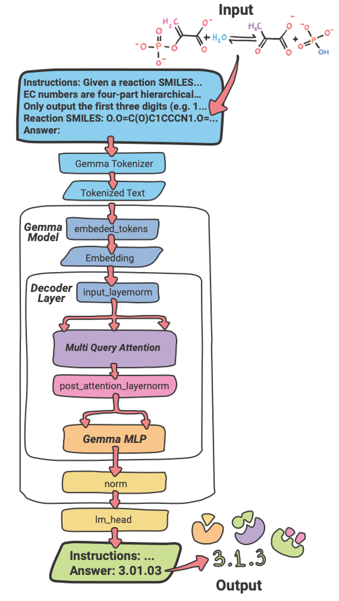

# Gemma4EC

<table>
  <tr>
    <td width="55%" valign="top">
      Predict Enzyme Commission (EC) numbers from biochemical reaction SMILES using Gemma4EC, a fine-tuned large language model.<br><br>
      Gemma4EC builds on <a href="https://deepmind.google/models/gemma/txgemma/">TxGemma</a> (Google's therapeutics LLM) and fine-tunes it for EC annotation via lightweight LoRA adapters.<br><br>
      <h2>Contents</h2>
      • <a href="#before-you-start">Before you start</a><br>
      • <a href="#installation">Installation</a><br>
      • <a href="#data">Data</a><br>
      • <a href="#predict-ec-numbers">Predict EC numbers</a><br>
      • <a href="#zero-shot-evaluation">Zero-shot evaluation</a><br>
      • <a href="#fine-tuning">Fine-tuning</a><br>
      • <a href="#benchmark-partitions">Benchmark partitions</a><br>
      • <a href="#hpc--slurm">HPC / SLURM</a><br>
      • <a href="#project-structure">Project structure</a><br>
      • <a href="#cite">Cite</a><br>
      • <a href="#contact">Contact</a>
    </td>
    <td width="45%" valign="top" align="center">
      
      <br>
      <em>Gemma4EC inference pipeline: TxGemma backbone with a LoRA adapter, a structured reaction SMILES prompt, and the predicted EC number as output.</em>
    </td>
  </tr>
</table>

---

## Before you start

You will need:

**1. A Hugging Face account** — [sign up here](https://huggingface.co/join)

**2. Access to [TxGemma](https://deepmind.google/models/gemma/txgemma/)** — request it on the model page (usually approved in minutes):
- [txgemma-9b-predict](https://huggingface.co/google/txgemma-9b-predict) — best accuracy
- [txgemma-2b-predict](https://huggingface.co/google/txgemma-2b-predict) — lighter, lower VRAM

**3. A GPU with enough VRAM:**

| Model | Min VRAM | Recommended hardware |
|---|---|---|
| `txgemma-9b-predict` | ~18 GB | A100 (40 GB), H100 |
| `txgemma-2b-predict` | ~6 GB | Any modern research GPU |

---

## Installation

```bash
git clone https://github.com/PlanesLab/gemma4ec.git
cd gemma4ec
conda env create -f envs/gemma4ec_env.yaml
conda activate gemma4ec
```

Log in to Hugging Face once (saves your token locally):
```bash
huggingface-cli login
```

---

## Data

All datasets are included in this repository under `data/`.

```
data/
├── ECReact/
│   ├── train.csv   (~49 k reactions)
│   ├── val.csv     (~6 k reactions)
│   └── test.csv    (~6 k reactions)
└── partitions/
    ├── Rhea_Scaffold/   train / val / test
    ├── Rhea_Stratified/ train / val / test
    └── Rhea_Time/       train / val / test
```

The ECReact split is derived from [ECReact-1.0](https://github.com/rxn4chemistry/biocatalysis-model/blob/main/data/ecreact-1.0.csv), a curated dataset of enzyme-catalysed reactions in SMILES format. The three Rhea partitions are built from the same reactions re-split using [Rhea](https://www.rhea-db.org/) metadata (scaffold, stratified, time).

Each CSV contains at minimum:

| Column | Description |
|---|---|
| `rxn_smiles` | Reaction SMILES string |
| `ec` | EC number label (e.g. `1.1.1.1`) |

The three Rhea partitions are described in the [Benchmark partitions](#benchmark-partitions) section.
To regenerate partition splits from `data/ECReact/`, see [`scripts/prepare_db.py`](scripts/prepare_db.py).

---

## Predict EC numbers

### Step 1 — Download the adapter

```bash
git clone https://huggingface.co/PlanesLab/Gemma4EC-9B-Predict models/Gemma4EC-9B-Predict
```

The folder must contain `adapter_model.safetensors` and `adapter_config.json`.

### Step 2 — Prepare your input CSV

Create a CSV with at minimum a `rxn_smiles` column:

```csv
rxn_smiles
CC(=O)O>>CC(=O)[O-]
OC(=O)CCC(=O)C(=O)O>>OC(=O)CCC(N)C(=O)O
```

### Step 3 — Run prediction

```bash
python predict.py \
  --raw_data_file reactions.csv \
  --model_checkpoint_folder models/Gemma4EC-9B-Predict
```

Predictions are saved as a TSV in `outputs/results/`.

**Using the 2B model:**
```bash
python predict.py \
  --raw_data_file reactions.csv \
  --model_checkpoint_folder models/Gemma4EC-2B-Predict \
  --model_id google/txgemma-2b-predict
```

**Key arguments:**

| Argument | Default | Description |
|---|---|---|
| `--raw_data_file` | *(required)* | Input CSV with `rxn_smiles` column |
| `--model_checkpoint_folder` | *(required)* | Path to the adapter folder |
| `--model_id` | `google/txgemma-9b-predict` | Base model ID |
| `--output_folder` | `./outputs/results` | Where to save the prediction TSV |
| `--eval_batch_size` | `8` | Reduce if you run out of VRAM |

For an interactive prediction demo see [`notebooks/predict_ec_numbers.ipynb`](notebooks/predict_ec_numbers.ipynb).

For attention-based mechanistic explanation (predict → attention heatmap → 4-turn TxGemma-Chat dialogue) see [`notebooks/mechanistic_explanation.ipynb`](notebooks/mechanistic_explanation.ipynb).

---

## Zero-shot evaluation

Evaluate the base [TxGemma](https://deepmind.google/models/gemma/txgemma/) model without any fine-tuning:

```bash
python predict_zeroshot.py \
  --test_csv data/ECReact/test.csv \
  --output_folder outputs/zeroshot
```

| Argument | Default | Description |
|---|---|---|
| `--test_csv` | `data/ECReact/test.csv` | Input CSV |
| `--output_folder` | `./outputs/zeroshot` | Output directory |
| `--eval_batch_size` | `16` | Batch size for generation |
| `--max_retries` | `5` | Per-sample retries for malformed outputs |
| `--disable_wandb` | — | Disable W&B logging |

---

## Fine-tuning

Fine-tune [TxGemma](https://deepmind.google/models/gemma/txgemma/) on your own reaction dataset using LoRA.

**Minimal usage:**
```bash
python main.py \
  --raw_data_folder data/ECReact \
  --disable_wandb
```

**Full example (with W&B logging):**
```bash
python main.py \
  --raw_data_folder data/ECReact \
  --model_id google/txgemma-9b-predict \
  --num_train_epochs 30 \
  --batch_size 8 \
  --lora_r 16 \
  --save_best true \
  --monitor_metric mcc \
  --wandb_project my_project \
  --wandb_entity my_team
```

**Key arguments:**

| Argument | Default | Description |
|---|---|---|
| `--model_id` | `google/txgemma-9b-predict` | Base model |
| `--num_train_epochs` | `30` | Training epochs |
| `--batch_size` | `8` | Per-device batch size |
| `--gradient_accumulation_steps` | `4` | Effective batch = batch × accum × n_gpus |
| `--learning_rate` | `5e-4` | Learning rate |
| `--lora_r` | `16` | LoRA rank |
| `--lora_alpha` | `16` | LoRA alpha |
| `--adapter_method` | `lora` | Adapter type: `lora`, `dora`, `adalora` |
| `--save_best` | `false` | Save best checkpoint by `--monitor_metric` |
| `--monitor_metric` | `mcc` | Metric for early stopping: `accuracy`, `mcc`, `f1_macro` |
| `--early_stopping_patience` | `5` | Stop after N epochs with no improvement |
| `--use_test` | `false` | Evaluate on test split after training |
| `--few_shot_training` | `false` | Mix few-shot examples into training prompts |
| `--disable_wandb` | — | Disable W&B logging |

Full documentation: [`docs/training.md`](docs/training.md)

---

## Benchmark partitions

To assess generalisation beyond random splits, we evaluate Gemma4EC on three [Rhea](https://www.rhea-db.org/) partitions
built from the same underlying dataset:

| Partition | Split strategy | Challenge |
|---|---|---|
| **Rhea_Scaffold** | Reactions grouped by Murcko scaffold — different scaffolds in train vs. test | Chemical novelty |
| **Rhea_Stratified** | Stratified random split preserving EC class balance | Standard baseline |
| **Rhea_Time** | Chronological split by reaction entry date | Temporal generalisation |

Data for all three partitions is in `data/partitions/`. To re-generate them from `data/ECReact/`:

```bash
python scripts/prepare_db.py --db Rhea_Scaffold   --out_root data/partitions
python scripts/prepare_db.py --db Rhea_Stratified --out_root data/partitions
python scripts/prepare_db.py --db Rhea_Time       --out_root data/partitions
```

To aggregate metrics across all models and partitions into a comparison table:

```bash
python scripts/summarize_results.py
```

---

## HPC / SLURM

For running on a cluster, all workflows have matching SLURM scripts in `slurm/`.

**Fine-tune Gemma4EC-9B on all three partitions:**
```bash
export HUGGINGFACE_TOKEN=hf_...
export WANDB_API_KEY=...
bash slurm/submit_all_partitions.sh
```

**Fine-tune Gemma4EC-2B on all three partitions:**
```bash
bash slurm/submit_all_partitions_2b.sh
```

**Theia baseline on all three partitions:**
```bash
bash slurm/submit_all_partitions_theia.sh
```

**BEC-Pred baseline on all three partitions:**
```bash
bash slurm/submit_all_partitions_becpred.sh
```

**Single partition (any model):**
```bash
DB_NAME=Rhea_Time sbatch slurm/run_train_partition.sh    # 9B
DB_NAME=Rhea_Time sbatch slurm/run_train_partition_2b.sh # 2B
DB_NAME=Rhea_Time sbatch slurm/run_train_theia.sh        # Theia
DB_NAME=Rhea_Time sbatch slurm/run_becpred.sh            # BEC-Pred
```

**Re-evaluate a saved checkpoint (no retraining):**
```bash
DB_NAME=Rhea_Time sbatch slurm/run_predict_partition.sh
```

**Zero-shot baseline:**
```bash
sbatch slurm/run_predict_zeroshot.sh
```

See [`slurm/README.md`](slurm/README.md) for the full list of scripts and options.

---

## Results

Benchmark on the standard test set (support-weighted MCC across all EC sub-subclasses):

| Model | Overall MCC | EC1 | EC2 | EC3 | EC4 | EC5 | EC6 | EC7 |
|---|---|---|---|---|---|---|---|---|
| **Gemma4EC-9b** | **0.903** | 0.848 | 0.971 | 0.772 | 0.849 | 0.780 | 0.895 | 0.433 |
| [BEC-Pred](https://github.com/KeeliaQWJ/BEC-Pred) | 0.886 | 0.799 | 0.965 | 0.777 | 0.834 | 0.681 | 0.869 | 0.314 |
| Theia | 0.880 | 0.806 | 0.958 | 0.733 | 0.814 | 0.740 | 0.824 | — |
| Gemma4EC-2b | 0.870 | 0.799 | 0.954 | 0.752 | 0.724 | 0.685 | 0.846 | 0.571 |
| [Gemini 2.5 Flash](https://ai.google.dev/gemini-api/docs?hl=es-419) | 0.774 | 0.593 | 0.927 | 0.555 | 0.737 | 0.496 | 0.669 | 0.000 |
| [ChatGPT-5 (v2)](https://openai.com/es-ES/api/) | 0.531 | 0.354 | 0.721 | 0.317 | 0.181 | 0.383 | 0.180 | 0.000 |
| [TxGemma-9b (zero-shot)](https://deepmind.google/models/gemma/txgemma/) | ~0.000 | — | — | — | — | — | — | — |

Metrics computed with [`results/compute_weighted_metrics.py`](results/compute_weighted_metrics.py). Full per-class table: [`results/summary/per_class_mcc.csv`](results/summary/per_class_mcc.csv).

---

## Project structure

```
gemma4ec/
├── main.py                        # LoRA fine-tuning entry point
├── predict.py                     # Inference with a LoRA adapter
├── predict_zeroshot.py            # Zero-shot inference (no adapter)
├── infer_attention.py             # BertViz attention visualisation
├── train_theia.py                 # Theia MLP baseline — train
├── eval_theia.py                  # Theia MLP baseline — evaluate
│
├── data/
│   ├── ECReact/                   # Full dataset from ECReact-1.0 (train / val / test CSVs)
│   └── partitions/                # Rhea_Scaffold / Rhea_Stratified / Rhea_Time splits
│
├── envs/
│   └── gemma4ec_env.yaml          # Conda environment
│
├── figures/                       # Paper figures
│
├── prompts/
│   └── prompts.json               # Prompt templates (few-shot, zero-shot, etc.)
│
├── results/
│   ├── compute_weighted_metrics.py        # Reproduce main benchmark table (weighted MCC)
│   ├── compute_per_class_and_splits.py    # Reproduce per-class and partition tables
│   ├── bec-pred/
│   │   └── results_test_ec.csv            # BEC-Pred predictions on the standard test set
│   ├── summary/
│   │   ├── weighted_metrics.csv           # All models — overall weighted MCC/PPV/Recall
│   │   ├── per_class_mcc.csv              # All models — MCC per EC class (1–7)
│   │   └── splits_weighted_mcc.csv        # Rhea splits — Gemma4EC / BEC-Pred / Theia
│   ├── ECReact/                           # Gemma4EC-9b fine-tuned on ECReact (gitignored)
│   ├── Rhea_Scaffold/                     # Gemma4EC-9b fine-tuned on Rhea_Scaffold
│   ├── Rhea_Stratified/                   # Gemma4EC-9b fine-tuned on Rhea_Stratified
│   └── Rhea_Time/                         # Gemma4EC-9b fine-tuned on Rhea_Time
│
├── scripts/
│   ├── prepare_db.py              # Generate Rhea partition splits
│   ├── canonicalize_smiles.py     # Canonicalize rxn_smiles in all data CSVs
│   ├── summarize_results.py       # Aggregate metrics across all models
│   ├── slim_bertviz.py            # Slim down BertViz HTML output files
│   └── make_attn_plotly.py        # Generate Plotly attention visualisations
│
├── slurm/
│   ├── run_train_partition.sh        # Fine-tune TxGemma-9B on one Rhea partition
│   ├── submit_all_partitions.sh      # Submit all three 9B partition jobs
│   ├── run_train_partition_2b.sh     # Fine-tune TxGemma-2B on one Rhea partition
│   ├── submit_all_partitions_2b.sh   # Submit all three 2B partition jobs
│   ├── run_predict_partition.sh      # Evaluate a saved 9B adapter (no retraining)
│   ├── run_predict_zeroshot.sh       # Zero-shot evaluation (no adapter)
│   ├── run_train_theia.sh            # Train Theia baseline on one partition
│   ├── submit_all_partitions_theia.sh# Submit all three Theia partition jobs
│   ├── run_eval_theia.sh             # Evaluate a pre-trained Theia model
│   ├── run_becpred.sh                # Run BEC-Pred pipeline on one partition
│   ├── submit_all_partitions_becpred.sh # Submit all three BEC-Pred partition jobs
│   ├── run_predict_api.sh            # API benchmarking (OpenAI / Gemini)
│   └── README.md
│
├── src/
│   ├── config.py
│   ├── datamod/                   # Data loading, prompt templates, JSONL builder
│   ├── evaluation/                # Evaluation loop, EC parsing, metrics saving
│   ├── models/                    # Model loading, PEFT config
│   ├── training/                  # SFT trainer, manual DDP loop, callbacks, checkpointing
│   ├── utils/                     # Metrics, path helpers, sequence length checks
│   └── bec-pred/                  # BEC-Pred baseline (see src/bec-pred/README.md)
│
├── notebooks/
│   ├── predict_ec_numbers.ipynb       # Interactive prediction demo
│   └── mechanistic_explanation.ipynb  # Attention heatmap + TxGemma-Chat mechanism
│
└── docs/
    ├── training.md
    ├── prediction_hpc.md
    ├── huggingface_authentication.md
    ├── api_benchmarking.md
    └── becpred_benchmarking.md
```

---

## Cite

> Citation to be added.

---

## Contact

| Name | Email |
|---|---|
| Josefina Arcagni | jarcagniriv@unav.es |
| Joseba Sancho-Zamora | jsanchoz@unav.es |
